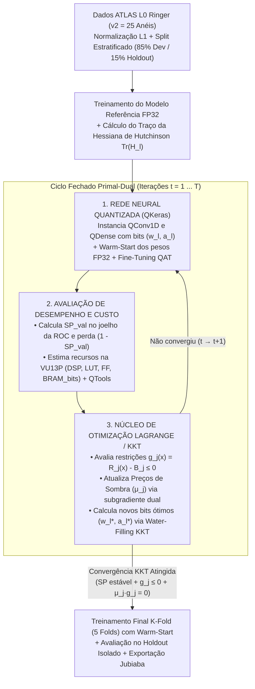

# Guia Completo do Pipeline: Processo de Treinamento, Otimização de Bits (Lagrange/KKT) e Estimação de Recursos na FPGA VU13P

Este documento detalha de ponta a ponta como o projeto executa o **treinamento da rede neural convolucional 1D (`QCNN1D`)**, a **otimização automática da largura de bits por camada via Multiplicadores de Lagrange e Condições de Karush-Kuhn-Tucker (KKT)** e a **estimação de recursos físicos na FPGA AMD/Xilinx Virtex UltraScale+ VU13P** com integração ao `qkeras.qtools`.

---

## Visão Geral do Ciclo Fechado em 3 Etapas

Todo o fluxo implementado em [`notebooks/01_quantized_cnn1d_optimization.ipynb`](file:///home/iaraujo/Documentos/Github/cnn-optimization/notebooks/01_quantized_cnn1d_optimization.ipynb) opera sobre um ciclo fechado de três estágios acoplados:

---

## Parte 1: O Processo de Pré-Processamento e Treinamento

### 1.1 Fatiamento Físico da Topologia `v2` (25 Anéis) e Normalização $L_1$
Os sinais de entrada provêm dos calorímetros eletromagnético (PS, EM1, EM2, EM3) e hadrônico (HAD1, HAD2, HAD3) do experimento ATLAS no LHC, na região cinemática $(\text{iet}=5, \text{ieta}=0)$, contendo um conjunto balanceado de **77.126 eventos** ($38.563$ elétrons de sinal com $y=1$ e $38.563$ jatos hadrônicos de ruído de fundo com $y=0$).

1. **Seleção dos 25 Anéis (`v2`)**: A função [`slice_rings_by_version(X_raw, version="v2")`](file:///home/iaraujo/Documentos/Github/cnn-optimization/src/metrics.py#L43-L81) extrai os primeiros anéis concêntricos mais internos de cada camada de amostragem a partir do vetor original de 100 anéis (`v0`):
   - `PS`: 2 anéis | `EM1`: 16 anéis | `EM2`: 2 anéis | `EM3`: 2 anéis | `HAD1`: 1 anel | `HAD2`: 1 anel | `HAD3`: 1 anel $\implies \mathbf{M = 25\text{ anéis}}$.
2. **Normalização $L_1$ por Evento**: A função [`norm1(X)`](file:///home/iaraujo/Documentos/Github/cnn-optimization/src/metrics.py#L84-L90) normaliza a energia depositada em cada anel pela energia absoluta total do respectivo chuveiro, garantindo invariância de escala frente à energia transversal ($E_T$):
   $$\hat{x}_i = \frac{x_i}{\sum_{m=1}^{25} |x_m|}, \quad i = 1, \dots, 25$$
3. **Particionamento Estratificado**:
   - **Conjunto de Desenvolvimento (`X_dev`, 85% = 65.557 eventos)**: utilizado para o treinamento de referência FP32, o loop de alocação de bits KKT e a validação cruzada em 5 folds;
   - **Conjunto de Teste Isolado (`X_holdout`, 15% = 11.569 eventos)**: mantido completamente intocado durante todo o treinamento e otimização, servindo exclusivamente para o laudo final de generalização.

---

### 1.2 Arquitetura da Rede Neural (`Compact_CNN1D_FP32` e `Compact_QCNN1D`)
Definida em [`src/models.py`](file:///home/iaraujo/Documentos/Github/cnn-optimization/src/models.py#L12-L126), a topologia é uma CNN 1D ultracompacta projetada para caber nos limites estritos de área e latência do *trigger* de Nível 0 (L0):

| Ordem | Camada (`name`) | Tipo (FP32 / QKeras) | Formato de Saída (`v2`) | Hiperparâmetros e Quantizadores | Parâmetros ($P_l$) | Operações ($\text{MAC}_l$) |
| :---: | :--- | :--- | :---: | :--- | :---: | :---: |
| 1 | `input_rings` / `reshape_1d` | `Input` + `Reshape` | $(25, 1)$ | Entrada normalizada $L_1$ | $0$ | $0$ |
| 2 | `conv1d_1` | `Conv1D` / `QConv1D` | $(25, 8)$ | $n_1 = 8$ filtros, $K = 3$, `padding="same"`, `quantized_bits(w_1, int_w1, alpha=1)` | $32$ | $600$ |
| 3 | `relu_conv1` | `ReLU` / `QActivation` | $(25, 8)$ | `quantized_relu(a_1, int_a1)` | $0$ | $0$ |
| 4 | `maxpool_1` + `flatten_1` | `MaxPooling1D(2)` + `Flatten` | $(96,)$ | Redução espacial $25 \to 12$ ($12 \times 8 = 96$) | $0$ | $0$ |
| 5 | `dense_1` | `Dense` / `QDense` | $(8,)$ | $n_2 = 8$ neurônios, `quantized_bits(w_2, int_w2, alpha=1)` | $776$ | $768$ |
| 6 | `relu_dense1` | `ReLU` / `QActivation` | $(8,)$ | `quantized_relu(a_2, int_a2)` | $0$ | $0$ |
| 7 | `output_dense` | `Dense` / `QDense` | $(1,)$ | $1$ neurônio, `quantized_bits(w_3, int_w3, alpha=1)` + `sigmoid` | $9$ | $8$ |
| **Total** | — | — | — | — | **$817$** | **$1.376$** |

---

### 1.3 Função de Perda Diferenciável vs. Critério Físico de Seleção (`SPCallback`)
Durante o treinamento supervisionado no TensorFlow/QKeras, utilizamos **duas métricas complementares**:

1. **Para o Cálculo dos Gradientes (*Backpropagation*) e `ReduceLROnPlateau`**:
   - Utiliza-se a **Entropia Cruzada Binária (`binary_crossentropy` / `val_loss`)** com o otimizador **Adam**. Como a entropia cruzada é suave e diferenciável em todos os pontos, ela fornece gradientes estáveis para atualizar os pesos (via *Straight-Through Estimator* - STE nos quantizadores QKeras) e orienta o agendador `ReduceLROnPlateau` (que reduz a taxa de aprendizado pela metade quando a `val_loss` estaciona por 3 épocas).
2. **Para a Avaliação Física, Seleção da Melhor Época e Parada Antecipada (`SPCallback`)**:
   - No sistema de *trigger* do ATLAS, é essencial maximizar simultaneamente a **Probabilidade de Detecção de Elétrons ($PD = TPR$)** e a **Rejeição de Jatos de Fundo ($1 - FA = 1 - FPR$)**.
   - Ao final de cada época, o callback [`SPCallback`](file:///home/iaraujo/Documentos/Github/cnn-optimization/src/metrics.py#L140-L216) varre todos os limiares possíveis $\tau \in [0, 1]$ da curva ROC de validação através de [`compute_sp_with_threshold()`](file:///home/iaraujo/Documentos/Github/cnn-optimization/src/metrics.py#L106-L137) e encontra o ponto de operação ótimo ("joelho" ou *knee* da ROC) que maximiza o **Índice Soma-Produto ($SP$)**:
     $$SP(\tau) = \sqrt{\sqrt{PD(\tau) \cdot (1 - FA(\tau))} \cdot \left[ \frac{PD(\tau) + (1 - FA(\tau))}{2} \right]}, \qquad SP_{\text{val}} = \max_{\tau \in [0, 1]} SP(\tau)$$
   - O `SPCallback` salva em memória os pesos da época que atingiu o maior $SP_{\text{val}}$ (`restore_best_weights()`) e interrompe o treinamento caso o $SP_{\text{val}}$ não supere a marca histórica por `patience` épocas consecutivas.

### 1.4 Transferência de Pesos (*Warm-Start* QAT)
A função [`transfer_weights_to_qmodel(model_fp32, qmodel)`](file:///home/iaraujo/Documentos/Github/cnn-optimization/src/models.py#L129-L146) copia os pesos já convergidos do modelo de referência FP32 para o modelo QKeras antes de iniciar o *Quantization-Aware Training* (QAT), eliminando variância estocástica de inicialização e acelerando a convergência.

---

## Parte 2: Como Funciona a Otimização da Quantidade de Bits (Lagrange e KKT)

O problema central consiste em escolher o vetor de larguras de bits de pesos $\mathbf{w} = [w_1, w_2, w_3]^T$ e ativações $\mathbf{a} = [a_1, a_2]^T$ que minimiza a perda de desempenho físico $\mathcal{L}_{\text{SP}}(\mathbf{x}) = 1 - SP_{\text{val}}(\mathbf{x})$ respeitando simultaneamente os limites máximos de recursos $B_j$ alocados à instância do classificador na FPGA **Virtex UltraScale+ VU13P**:

$$\min_{\mathbf{x} = (\mathbf{w}, \mathbf{a})} \mathcal{L}_{\text{SP}}(\mathbf{x}) = 1 - SP_{\text{val}}(\mathbf{x}) \quad \text{sujeito a} \quad g_j(\mathbf{x}) = R_j(\mathbf{x}) - B_j \le 0, \quad \forall j \in \{\text{DSP}, \text{LUT}, \text{FF}, \text{BRAM\_bits}\}$$

A resolução implementada em [`src/kkt_allocator.py`](file:///home/iaraujo/Documentos/Github/cnn-optimization/src/kkt_allocator.py) combina **Sensibilidade Hessiana de 2ª Ordem** (nível intra-camada) com **Ascensão Dual de Multiplicadores de Lagrange** (nível de recursos da VU13P):

1. **Sensibilidade de Curvatura via Algoritmo de Hutchinson ($\operatorname{Tr}(\mathbf{H}_l)$ e $c_l$)**:
   - [`compute_hutchinson_hessian_trace`](file:///home/iaraujo/Documentos/Github/cnn-optimization/src/kkt_allocator.py#L8-L60) estima o traço da Hessiana de cada camada usando produtos Hessiana-vetor (HVP) com vetores de Rademacher $\mathbf{z} \in \{-1, +1\}^{P_l}$, e [`compute_layer_c_coefficients`](file:///home/iaraujo/Documentos/Github/cnn-optimization/src/kkt_allocator.py#L63-L85) computa $c_l = \operatorname{Tr}(\mathbf{H}_l) \frac{P_l \, r_l^2}{3}$.
2. **Passo Dual (Preços de Sombra $\mu_j$ na VU13P)**:
   - [`LagrangeKKTQuantizerOptimizer`](file:///home/iaraujo/Documentos/Github/cnn-optimization/src/kkt_allocator.py#L232-L402) calcula as violações normalizadas $\tilde{g}_j(\mathbf{x}^{(t)}) = (R_j(\mathbf{x}^{(t)}) - B_j)/\max(B_j, 1)$ e atualiza os preços de sombra $\mu_j^{(t+1)}$ via subgradiente dual com projeção de folga complementar.
3. **Passo Primal (*Water-Filling* Analítico KKT)**:
   - Quando $\mu_{\text{DSP}} > 0$, impõe $w_l, a_l \le 8\text{ bits}$ (zerando o uso de `DSP48E2`). Quando $\mu_{\text{LUT}} > 0$ ou $\mu_{\text{BRAM}} > 0$, resolve analiticamente a condição de estacionaridade KKT em [`solve_kkt_bit_allocation()`](file:///home/iaraujo/Documentos/Github/cnn-optimization/src/kkt_allocator.py#L88-L188):
     $$w_l^*(\lambda) = \operatorname{clip}\!\left( \frac{1}{2} \log_2\!\left( \frac{c_l \ln 4}{\lambda \cdot \text{MAC}_l \cdot a_l} \right), \, b_{\min}, \, b_{\max} \right)$$
   - Converge na **Iteração #5** com `w = {'conv1d_1': 2, 'dense_1': 5, 'output_dense': 8}` e `a = {'conv1d_1': 8, 'dense_1': 8}`.

---

## Parte 3: Estimação de Recursos na VU13P e Integração com `qkeras.qtools`

Em [`src/hardware.py`](file:///home/iaraujo/Documentos/Github/cnn-optimization/src/hardware.py), a estimação combina o modelo aritmético de síntese UltraScale+ com a inspeção direta do grafo quantizado via **`qkeras.qtools`**:

1. **Extração Exata de Tipos `ap_fixed<W, I>` e Energia via `qkeras.qtools` (`extract_qtools_hardware_profile`)**:
   - Infere automaticamente a largura real dos **multiplicadores (`mult_bits`)** e **acumuladores (`acc_bits`, `acc_int_bits`)** necessária para evitar *overflow* em hardware:
     - `conv1d_1` ($w_1=2, a_1=8$): multiplicador `ap_fixed<10, 2>`, acumulador **`ap_fixed<12, 4>`**;
     - `dense_1` ($w_2=5, a_2=8$): multiplicador `ap_fixed<13, 5>`, acumulador **`ap_fixed<20, 12>`**;
     - `output_dense` ($w_3=8, a_3=8$): multiplicador `ap_fixed<16, 5>`, acumulador **`ap_fixed<20, 9>`**;
   - Calcula o consumo energético por inferência em **picojoules (pJ)** via `qtools.pe()` ($240\text{ pJ}$ de núcleo computacional / $271\text{ pJ}$ incluindo I/O para o modelo ótimo KKT).
2. **Mapeamento em Recursos da Virtex UltraScale+ VU13P (`estimate_hardware_resources` & `estimate_vu13p_detailed_resources`)**:
   - **DSP48E2 vs. CLB LUTs**: para $w_l \le 8, a_l \le 8$, $\text{DSP}_l = 0$ e $\text{LUT}_l = \text{MAC}_l (w_l \cdot a_l)/18$, além de decompor as LUTs de multiplicadores vs. árvores de soma (`LUT_adder_tree_rf`) em função do `ReuseFactor` ($RF_l$);
   - **Flip-Flops e Line Buffers 1D**: estima os registradores de janela deslizante 1D da `QConv1D` (`FF_line_buffer`) e os registradores de *datapath* (`FF_datapath_rf`);
   - **Memória On-Chip (`BRAM_bits` / `LUTRAM_bits`)** e **Latência em Ciclos e Nanossegundos** ($\text{Latência}_l = RF_l + \lceil \log_2(\text{fan-in}_l) \rceil + 1$ ciclos a $250\text{ MHz} \to 4,0\text{ ns/ciclo}$).
